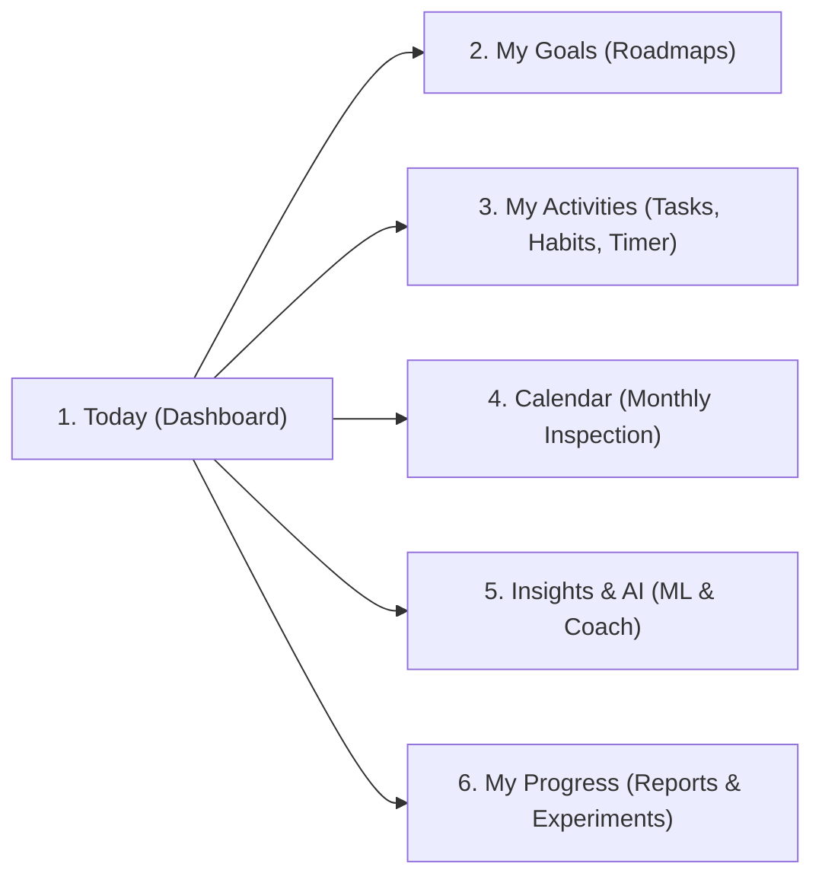
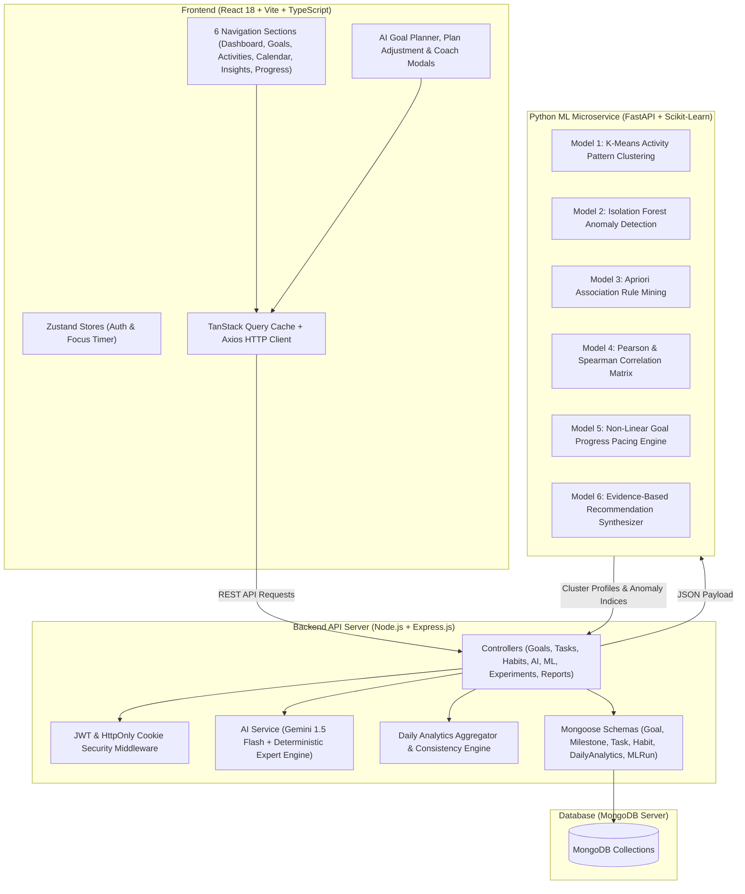

# ConsistAI ML
## Intelligent Goal Progress Analysis and Workflow Improvement System
### B.Tech Computer Science and Engineering — Minor Project


---

## 1. Executive Summary & Objective

**ConsistAI ML** is an end-to-end, empirical web application designed for students, competitive programmers, and engineers. It enables users to set structured goals, decompose milestones, plan daily tasks, track routine habits, record focused working hours, log digital screen distraction, and use Machine Learning to discover **retrospective operational patterns** and **workflow anomalies** that systematically hinder progress.

### Core Distinguishing Principles
> [!IMPORTANT]
> 1. **Strict Non-Forecasting Constraint**: ConsistAI ML does **NOT** deploy speculative future productivity forecasting or probability-of-success regressions. Instead, Machine Learning is leveraged strictly for **historical pattern discovery**, **multivariate anomaly isolation**, **habit co-occurrence association mining**, and **evidence-based workflow improvement experiments**.
> 2. **Empirical Grounding Over Hallucination**: AI suggestions and coach recommendations are grounded in actual MongoDB user logs (completed tasks, focus minutes, distraction, and milestone deltas) rather than generic motivational text.
> 3. **Dual AI Engine Architecture**: Supports Google Gemini 1.5 Flash when `GEMINI_API_KEY` is provided, and automatically falls back to an offline, deterministic heuristic expert engine if no API key is configured.

---

## 2. Six Primary Application Workflows

ConsistAI ML organizes productivity workflows around six core daily pillars:



1. **Today (`/`)**:
   - Primary goal pacing indicator with mathematical pacing gap (`Actual Progress % - Elapsed Time %`).
   - "Adjust My Plan" trigger when fallen behind pace.
   - Today's priority tasks (goal-linked, high priority, pending deadlines) with 1-click completion.
   - Scheduled daily habits with streak counters.
   - Quick Focus launcher (inline Pomodoro / countdown / stopwatch tied to goals).
   - High-value AI insight of the day with 1-click 14-day workflow experiment launch.
   - Key operational metrics (task completion rate, habit adherence, focus hours, consistency score).

2. **My Goals (`/goals`)**:
   - Structured goal creation and tracking.
   - **AI Goal Planner**: Natural language input (e.g., *"Complete 200 DSA problems in 90 days"*) decomposes into structured milestones, weekly objectives, recommended habits, and feasibility checks.
   - Milestone progress tracking with weighted contributions.
   - **AI Plan Adjustment**: Rebalance milestone weights and recalibrate deadlines without destructive rewrites.

3. **My Activities (`/activities`)**:
   - Unified hub combining **Tasks** (`/tasks`), **Todo List** (`/todos`), **Habit Tracker** (`/habits`), **Focus Timer** (`/timer`), and **Screen Time** (`/screentime`).
   - Natural language **Quick Capture** bar (e.g., *"Practice Dynamic Programming for 45 minutes"*).
   - Filter tasks by cadence: Daily, Weekly, Monthly, and Completed.
   - Convert lightweight todo items into structured tracked tasks.

4. **Calendar (`/calendar`)**:
   - Comprehensive monthly productivity calendar.
   - Filter indicators by Tasks, Habits, Goals, and Focus Sessions.
   - Interactive date inspector showing completed work, focus sessions, screen time, and consistency scores.
   - Built-in rest day recognition to prevent punishing planned recovery.

5. **Insights & AI (`/insights`)**:
   - **AI Progress Coach (`/coach`)**: Grounded chat assistant answering queries based on actual historical logs.
   - **ML Pattern Discovery (`/ml-patterns`)**: K-Means clustering, Isolation Forest anomaly detection, Apriori association mining, and Pearson/Spearman correlations.
   - **Workflow Suggestions (`/recommendations`)**: Rule-based and pattern-backed suggestions convertible into 14-day experiments.

6. **My Progress (`/progress`)**:
   - **Monthly Reports (`/reports`)**: Printable academic productivity evaluation reports.
   - **Improvement Experiments (`/experiments`)**: 14-day controlled A/B workflow tests comparing baseline vs active experimental periods.
   - **Goal Analytics (`/analytics`)**: Cumulative milestone velocity and pacing trajectory charts.

---

## 3. System Architecture



---

## 4. Mathematical Formulations & ML Algorithms

### 4.1 Numerical & Milestone Goal Progress
For quantitative targets (e.g., *Solve 200 DSA Problems*):
$$\text{Goal Progress} = \min\left(100\%, \frac{\text{Achieved Quantity}}{\text{Target Quantity}} \times 100\right)$$

For structured, non-linear milestone milestones (e.g., Arrays 20%, Trees 20%, DP 30%):
$$\text{Milestone Goal Progress} = \min\left(100\%, \frac{\sum_{i=1}^M \left(w_i \times \frac{\text{Achieved}_i}{\text{Target}_i}\right)}{\sum_{i=1}^M w_i} \times 100\right)$$
*Displayed progress is capped at 100%, and routine habit completion is strictly isolated from milestone progress.*

### 4.2 Non-Linear Progress Pacing Gap
$$\text{Progress Gap} = \text{Actual Progress Percentage} - \text{Elapsed Time Percentage}$$
- **Ahead**: $\text{Gap} \ge +5\%$
- **On Pace**: $-5\% \le \text{Gap} < +5\%$
- **Mild Deficit**: $-15\% \le \text{Gap} < -5\%$
- **Critical Deficit**: $\text{Gap} < -15\%$ (Triggers "Adjust My Plan" prompt)

### 4.3 Composite Daily Consistency Score
$$S_{\text{consistency}} = 0.35 \cdot H_{\text{adherence}} + 0.30 \cdot T_{\text{completion}} + 0.25 \cdot \min\left(1.0, \frac{W_{\text{minutes}}}{180}\right) + 0.10 \cdot \max\left(0.0, 1 - \frac{D_{\text{screen}}}{150}\right)$$
*Planned rest days or holidays are indexed at baseline $75\%$ to prevent punishing intentional recovery.*

### 4.4 ML Model 1: K-Means Clustering on Daily Behavioral Patterns
Standardizes 6 behavioral inputs: focused work minutes, habit adherence rate, task completion rate, distracting screen time, goal-specific hours, and planned tasks.
$$\text{Silhouette Score: } s(i) = \frac{b(i) - a(i)}{\max(a(i), b(i))}$$
> [!NOTE]
> **Held-Out Target Outcome**: Actual daily goal progress delta ($\Delta_{\text{prog}}$) is deliberately held out from cluster formation and used solely to evaluate which activity profiles yielded real milestone gains.

### 4.5 ML Model 2: Isolation Forest Workflow Anomaly Detection
Isolates outlier operational days (high hours with 0 progress, sudden drops in routine, distraction surges):
$$s(x, n) = 2^{-\frac{E(h(x))}{c(n)}}, \quad c(n) = 2\left(\ln(n-1) + 0.5772156649\right) - \frac{2(n-1)}{n}$$
Identifies contributing feature drivers via multivariate standardized z-score deviations:
$$z_j = \frac{x_j - \mu_j}{\sigma_j}$$

### 4.6 ML Model 3: Apriori Association Rule Mining
Categorical transaction mining over discretized daily habits, work blocks, distraction levels, and milestone events:
$$\text{Support}(A \Rightarrow B) = P(A \cup B), \quad \text{Confidence}(A \Rightarrow B) = \frac{P(A \cup B)}{P(A)}, \quad \text{Lift}(A \Rightarrow B) = \frac{\text{Confidence}(A \Rightarrow B)}{P(B)}$$
*Filtered for Lift $> 1.05$ and Confidence $\ge 0.45$. Disclaimers explicitly specify co-occurrence, not causal proof.*

### 4.7 ML Model 4: Pearson & Spearman Statistical Correlations
Linear correlation ($r$) and monotonic rank correlation ($\rho$) assessing the exact statistical alignment between focus sessions, distraction, and goal progress delta.

---

## 5. Technology Stack

| Layer | Technologies |
| :--- | :--- |
| **Frontend** | React 18, Vite, TypeScript, Tailwind CSS, Zustand, TanStack Query, React Router DOM, Recharts, Lucide React, Axios |
| **Backend API** | Node.js, Express.js (ES Modules), MongoDB, Mongoose ODM, JWT, Cookie-Parser, Multer |
| **AI Integration** | Google Gemini 1.5 Flash API + Deterministic Heuristic Expert Engine |
| **Machine Learning** | Python, FastAPI, NumPy, SciPy, Pandas, Scikit-learn, Mlxtend, Joblib, Uvicorn, Pydantic |
| **Testing** | Node built-in test runner (`node --test`), Python `unittest` |

---

## 6. Step-by-Step Installation & Setup

### Prerequisites
- **Node.js** v18+ (tested on Node v24)
- **Python** 3.10+ (tested on Python 3.14)
- **MongoDB** running locally on port 27017 (`mongodb://127.0.0.1:27017`)
- *(Optional)* `GEMINI_API_KEY` for live Google Gemini LLM responses (app works 100% offline with built-in heuristic AI fallback).

---

### Step 1: Start the Python ML Service
```bash
# Navigate to ml-service directory
cd ml-service

# Install dependencies
python -m pip install -r requirements.txt

# Start the FastAPI ML microservice (Port 8000)
python main.py
```
*Health verification: `http://localhost:8000/health`*

---

### Step 2: Start the Node.js Backend API
```bash
# In a new terminal, navigate to backend directory
cd backend

# Install npm dependencies
npm install

# Start the Express server (Port 5000)
npm start
```
*Health verification: `http://localhost:5000/api/health`*

---

### Step 3: Start the React Frontend Application
```bash
# In a new terminal, navigate to frontend directory
cd frontend

# Install frontend dependencies
npm install

# Start Vite dev server (Port 5173)
npm run dev
```
*Access the Web Application in your browser: `http://localhost:5173`*

---

## 7. One-Click Demonstration & Evaluation Guide

For academic presentation and viva demonstration:
1. Open `http://localhost:5173`.
2. Click the **"Instant 1-Click Demo Login"** button on the Login page.
3. In the sidebar, click **"Load 60-Day Demo"** to generate 60 authentic historical days of:
   - "Complete 200 DSA Problems" goal with 6 milestones
   - Real habits (DSA practice, System Design, Morning Exercise)
   - Productive vs distracting screen time logs
   - Focus timer sessions
   - Pre-computed K-Means clusters (Optimal $k=3$, Silhouette $0.539$)
   - Isolation Forest anomaly flags with factor breakdowns
   - Apriori association rules (Lift up to $4.09\times$)
   - Active 14-day workflow experiment with before-and-after baseline comparisons!
4. **Demonstrate AI Goal Planner**: Click `My Goals` -> `AI Goal Planner` -> enter a goal description -> inspect generated milestones -> enroll with 1 click.
5. **Demonstrate AI Plan Adjustment**: Click `Adjust My Plan` on a lagging milestone -> review weight rebalancing -> apply.
6. **Demonstrate AI Progress Coach**: Click `Insights & AI` -> `AI Progress Coach` -> ask questions or click query chips.
7. **Demonstrate Quick Capture**: Click `My Activities` -> `Tasks` -> type a task in natural language -> add instantly.

---

## 8. Running Automated Tests

### Backend Test Suite
```bash
cd backend
npm test
```
*Validates Mongoose models, password hashing, milestone progress calculation, daily consistency scores, todo-to-task conversion, cadence filtering, and AI service generation.*

### Python ML Test Suite
```bash
python -m unittest discover -s ml-service/tests -p "test_*.py"
```
*Validates K-Means clustering, silhouette scoring, Isolation Forest anomaly detection, Apriori association rules, and recommendation synthesis.*

### Standalone Model Evaluation Script
```bash
python ml-service/evaluation/evaluate_models.py
```
*Outputs detailed terminal evaluation of silhouette score, anomaly counts, association rules table, and correlation p-values.*

---

## 9. Academic Deliverables
- **Architecture & System Design**: This `README.md`
- **Minor Project Academic Report Outline**: [`docs/MINOR_PROJECT_REPORT.md`](file:///d:/websites/habitAI/docs/MINOR_PROJECT_REPORT.md)
- **Live Demonstration & Defense Script**: [`docs/DEMO_GUIDE.md`](file:///d:/websites/habitAI/docs/DEMO_GUIDE.md)
- **Jupyter Notebook for Evaluation**: [`ml-service/evaluation/ml_evaluation_notebook.ipynb`](file:///d:/websites/habitAI/ml-service/evaluation/ml_evaluation_notebook.ipynb)

---
*ConsistAI ML — Intelligent Goal Progress Analysis and Workflow Improvement System (CSE Minor Project)*
